# Como ativar um subdomínio na CDN da Edgium

Este guia leva você do cadastro de um subdomínio até o **HTTPS ativo**, passo a passo, usando o painel da Edgium. O painel acompanha tudo por você: em cada momento ele mostra em qual dos **8 passos** o seu subdomínio está, o que já foi feito e quem age agora (você ou a Edgium).

Prefere assistir? Veja o [vídeo do passo a passo](ativar-subdominio/ativacao-subdominio.mp4) (1 min 45 s, com legendas em português; arquivos de legenda [`.vtt`](ativar-subdominio/ativacao-subdominio.vtt) e [`.srt`](ativar-subdominio/ativacao-subdominio.srt)).

> As imagens deste guia usam dados de demonstração.

**Os 8 passos**

| # | Passo | Quem age |
|---|---|---|
| 1 | Site cadastrado | você |
| 2 | Enviando para a rede | Edgium |
| 3 | Aponte seu DNS | você |
| 4 | Aguardando validação do DNS | Edgium |
| 5 | Ative o certificado | você |
| 6 | Emitindo certificado | Edgium |
| 7 | Certificado na rede | Edgium |
| 8 | HTTPS ativo | você liga, a Edgium aplica |

Você faz quatro ações: cadastrar o subdomínio, criar o registro no DNS, pedir o certificado e ligar o HTTPS. O resto é automático.

---

## 1. Cadastre o subdomínio (passo 1: Site cadastrado)

**O que fazer.** No painel, abra **CDN**, escolha o domínio e clique em **Adicionar subdomínio**. Digite só a parte antes do ponto (por exemplo `loja`); o domínio já aparece ao lado. Para usar o próprio domínio, sem prefixo, marque **Domínio raiz**. Depois clique em **Avançar**.

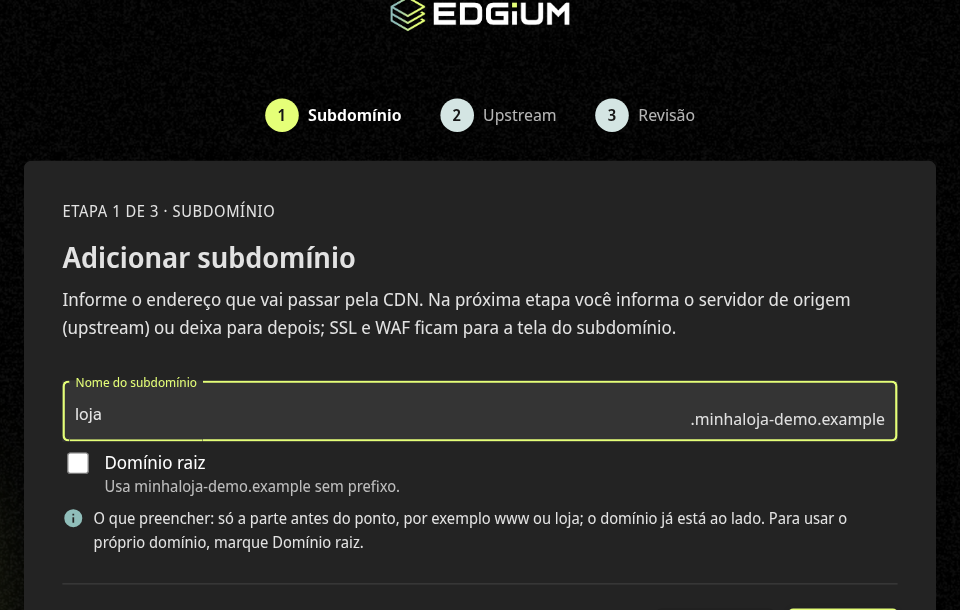

Na etapa 2, informe o **servidor de origem (upstream)**: o endereço IP e a porta do servidor onde o seu site está hospedado, ou seja, para onde a CDN vai buscar o conteúdo. Deixe **Ativar ao criar** marcado e clique em **Avançar**.

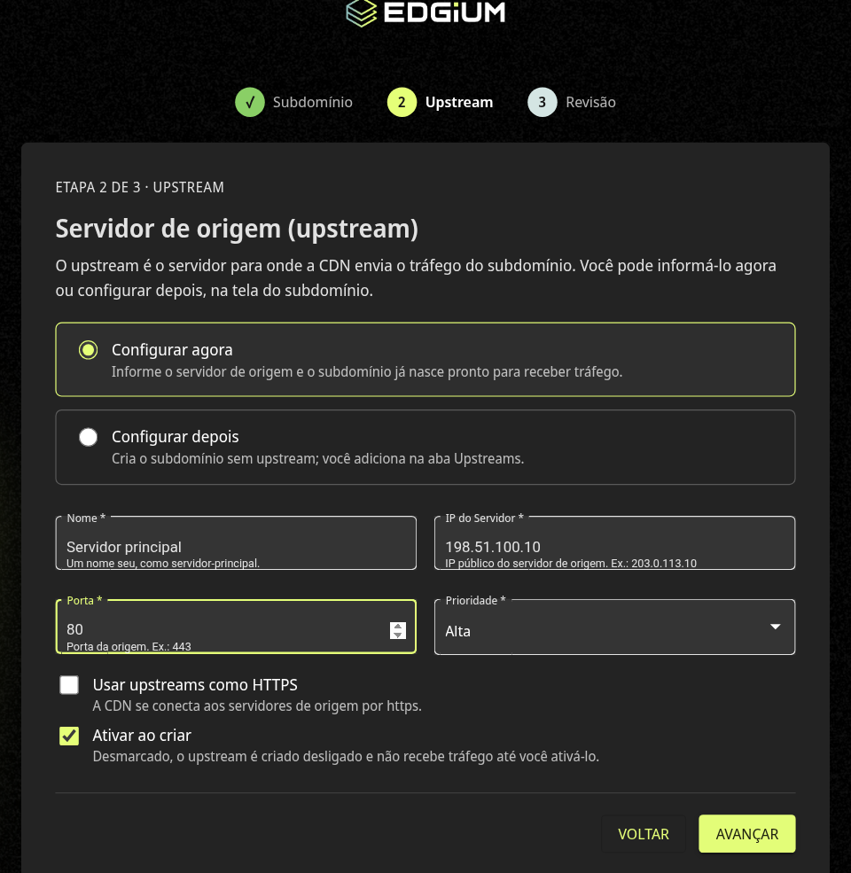

Na etapa 3, confira o resumo e clique em **Criar subdomínio**.

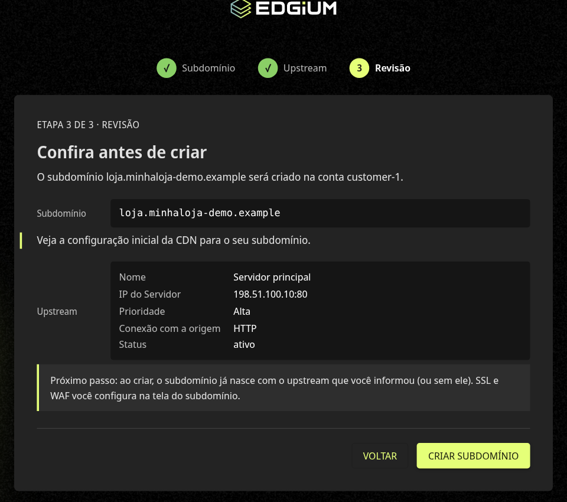

**O que esperar.** O painel abre a tela do subdomínio, na aba **Visão geral**, com o quadro **Ativação do subdomínio**. O passo 1, **Site cadastrado**, já aparece como **Concluído**.

## 2. A Edgium envia a configuração para a rede (passo 2: Enviando para a rede)

**O que fazer.** Nada. Este passo é da Edgium.

**O que esperar.** O passo 2 aparece como **Em andamento** e costuma levar até 30 minutos. Você já pode seguir para o passo 3 enquanto isso acontece.

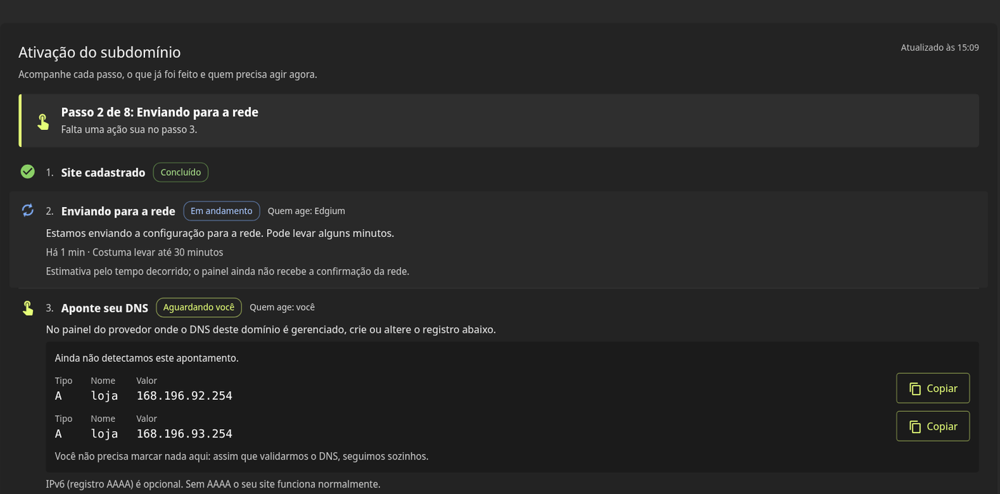

## 3. Aponte o seu DNS (passos 3 e 4)

**O que fazer.** No provedor onde o DNS do seu domínio é gerenciado, crie o registro mostrado no passo 3 da Visão geral:

| Tipo | Nome | Valor |
|---|---|---|
| A | o nome do subdomínio (nos exemplos, `loja`) | o endereço que o painel mostra |

O painel mostra o **valor exato** do seu registro, com um botão **Copiar** ao lado de cada endereço. Nos exemplos deste guia os valores são `168.196.92.254` e `168.196.93.254`; crie um registro A para cada endereço que o painel exibir. O registro AAAA (IPv6) é opcional: sem ele o seu site funciona normalmente.

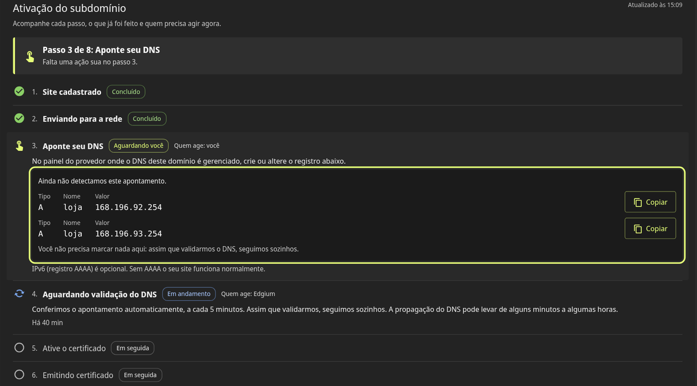

**O que esperar.** Você não precisa marcar nada no painel. O passo 4, **Aguardando validação do DNS**, é da Edgium: ela confere o apontamento automaticamente, a cada 5 minutos. A propagação do DNS pode levar de alguns minutos a algumas horas, dependendo do seu provedor. Quando o DNS for validado, os passos 3 e 4 passam para **Concluído** e o painel segue sozinho para o passo 5.

## 4. Ative o certificado (passo 5)

**O que fazer.** Com o DNS validado, o botão **Ir para a aba SSL** fica disponível no passo 5. Clique nele.

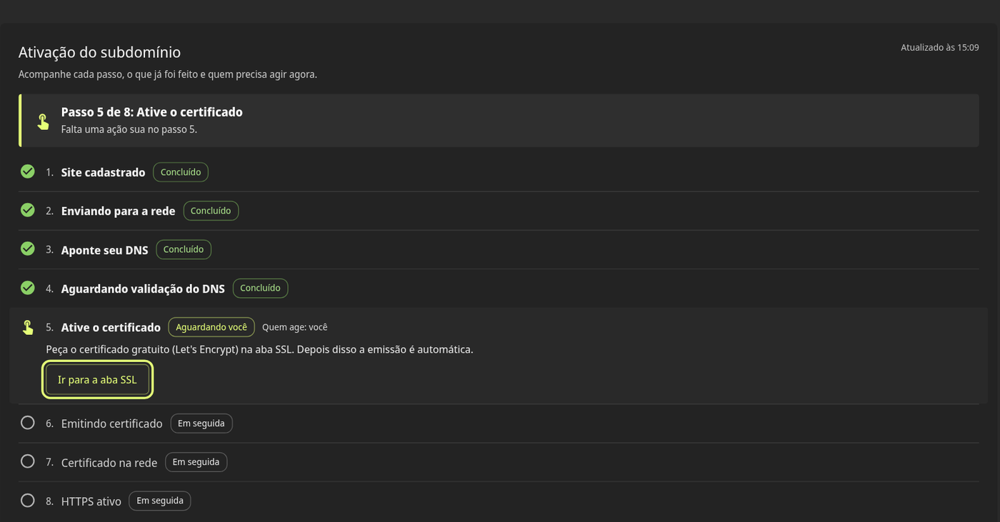

Na aba **SSL**, no bloco do certificado gratuito, clique em **Criar**.

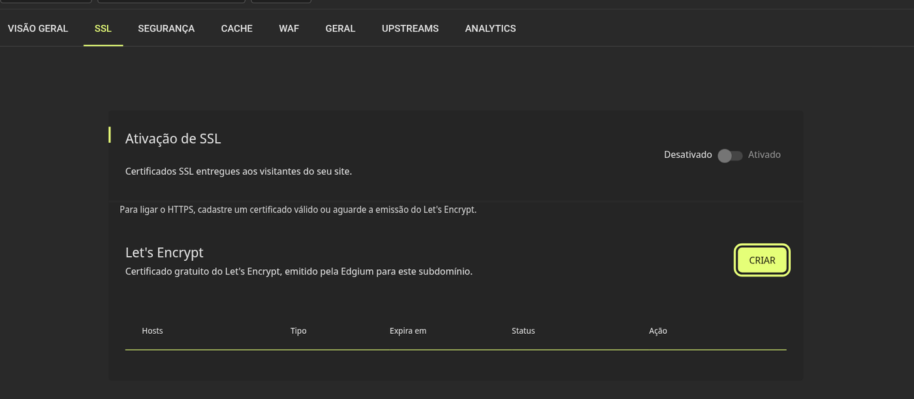

**O que esperar.** O pedido aparece na lista da aba SSL e o passo 5 passa para **Concluído**. A partir daqui a emissão é automática.

## 5. A Edgium emite o certificado (passo 6: Emitindo certificado)

**O que fazer.** Nada.

**O que esperar.** O passo 6 fica **Em andamento** e costuma levar até 15 minutos. Ao terminar, ele passa para **Concluído**.

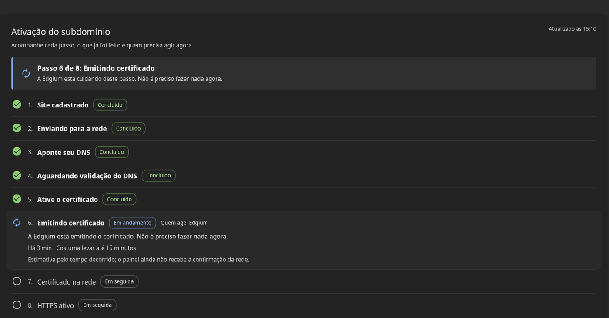

## 6. O certificado chega à rede (passo 7: Certificado na rede)

**O que fazer.** Nada.

**O que esperar.** A Edgium distribui o certificado para a rede, o que costuma levar até 30 minutos. Quando termina, o passo 7 passa para **Concluído** e o botão do passo 8 é liberado.

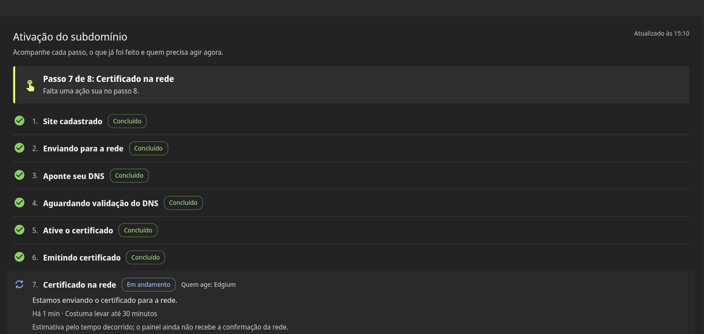

## 7. Ative o HTTPS (passo 8: HTTPS ativo)

**O que fazer.** Com o certificado na rede, o passo 8 mostra o botão **Ativar o HTTPS na aba SSL**. Clique nele e, na aba **SSL**, ligue a chave **Ativação de SSL** (de **Desativado** para **Ativado**).

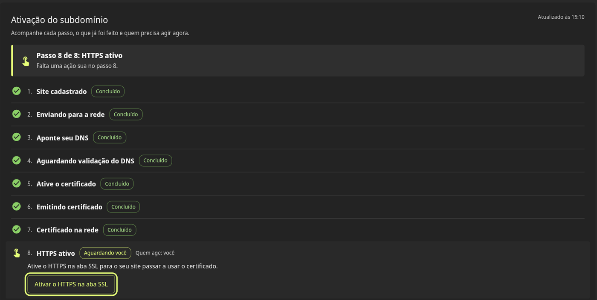

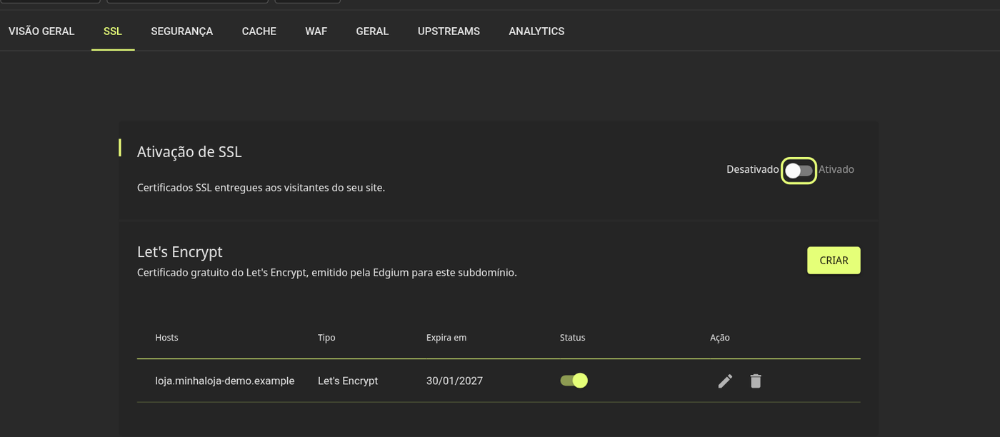

**O que esperar.** O certificado aparece como ativo na lista e a Edgium aplica a mudança na rede.

## 8. Confirme que funcionou

Volte à aba **Visão geral**. Quando tudo estiver pronto, o painel mostra a mensagem **Tudo pronto: HTTPS ativo** e "Seu subdomínio está ativo".

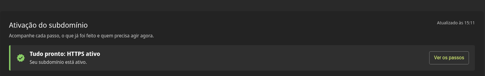

Clique em **Ver os passos** para rever o caminho completo, com os 8 passos **Concluídos**.

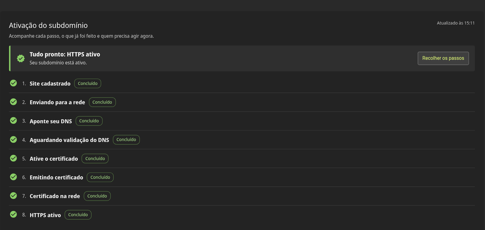

Para conferir também pelo navegador, abra `https://` seguido do endereço do seu subdomínio: a página carrega com o cadeado de conexão segura.

---

## Dicas

- A tela atualiza sozinha enquanto há um passo em andamento. Você pode fechar o painel e voltar depois: o passo atual continua marcado.
- Na lista de subdomínios da CDN, cada subdomínio mostra o indicador "Passo n de 8", e o filtro **Mostrar só o que precisa de ação** mostra apenas os que esperam por você.

## Precisa de ajuda?

- Se algo no seu acesso ou no seu site não sair como esperado, reúna as informações do guia [Problemas de acesso a um site na CDN: o que coletar e enviar](problemas-de-acesso-cdn.md) e envie para a nossa equipe.
- Fale com a gente: [suporte@edgium.net](mailto:suporte@edgium.net).
