# Novidades do Painel CDN da Edgium: novembro de 2026

Em 2 de novembro de 2026 entrou no ar uma versão renovada do painel da CDN e do DNS da Edgium. Esta página conta, de forma direta, **o que mudou, como usar e como interpretar o que a tela mostra**. Ela foi escrita para quem opera sites e lojas, não para quem administra servidores: onde há um termo técnico, explicamos o que ele quer dizer e o que fazer em seguida.

Os destaques:

- **Analytics refeito**: resumo claro, saúde da sua origem, erros explicados (502, 503, 504, 499 e família 4xx), mapa de acessos e as páginas que mais pedem ao seu servidor.
- **Logs do WAF mais úteis**: cada bloqueio mostra o motivo e a regra, com explicação em português.
- **Gestor de DNS com revisão antes de salvar**, botão Desfazer, histórico de alterações e mensagens de erro que dizem o que corrigir.
- **Painel mais seguro e mais fácil de navegar**: Perfil com troca de senha, confirmação digitando o nome antes de apagar e troca rápida de domínio.
- **Assistente de novo subdomínio** passo a passo, já com a origem (upstream) e os padrões certos ligados.

> Todas as imagens desta página foram feitas em um ambiente de demonstração, com dados fictícios (domínios de exemplo, endereços de documentação e tráfego simulado). Os números das telas servem para ilustrar a leitura, não representam nenhum cliente.

**Índice**

1. [Entrar no painel](#1-entrar-no-painel)
2. [Navegação](#2-navegação)
3. [Analytics](#3-analytics)
4. [Logs do WAF](#4-logs-do-waf)
5. [DNS](#5-dns)
6. [Outras melhorias de interface](#6-outras-melhorias-de-interface)
7. [Novo subdomínio: o assistente passo a passo](#7-novo-subdomínio-o-assistente-passo-a-passo)
8. [Precisa de ajuda?](#8-precisa-de-ajuda)

---

## 1. Entrar no painel

As contas são criadas pela nossa equipe. Na tela de entrada, quem ainda não é cliente encontra o link **Fale com a gente**; quem já é cliente entra com e-mail e senha e, se esquecer a senha, usa **Esqueci minha senha**.

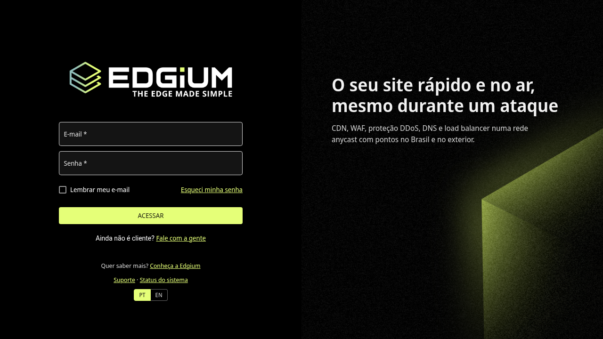

---

## 2. Navegação

O painel foi organizado em três níveis, sempre visíveis no alto da tela:

**Conta > Domínio > Subdomínio**

- O **menu da esquerda** leva aos produtos (DNS, CDN) e à ajuda (Suporte e Status do sistema).
- Dentro de um subdomínio da CDN, as **abas** reúnem tudo em um lugar: Visão geral, SSL, Segurança, Cache, WAF, Geral, Upstreams e Analytics.
- O campo **Buscar em tudo** (atalho `Ctrl + K`) abre uma busca para pular direto para qualquer tela.

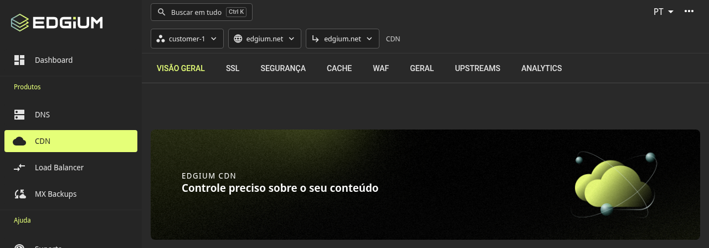

---

## 3. Analytics

O Analytics responde a quatro perguntas, na ordem em que aparecem na tela:

1. **Quanto o meu site foi acessado e como foi entregue?** (Resumo)
2. **Se algo está lento ou com erro, o problema é o meu servidor ou a CDN?** (Saúde da origem)
3. **O cache está ajudando?** (Tráfego e Cache)
4. **Quem está acessando?** (Países, endereços, HTTP e HTTPS)

Dois conceitos ajudam na leitura:

- **Origem (ou upstream)** é o *seu* servidor, de onde a CDN busca o que ainda não está guardado em cache.
- **Cache** é a cópia que a CDN guarda para entregar mais rápido. Quanto mais acessos saem do cache, menos trabalho o seu servidor tem.

### 3.1 Período, filtros e atalhos

No alto da tela você escolhe o período (**6 horas, 24 horas, 7 dias ou 30 dias**) e pode refinar com **+ Filtro**. Os filtros viram "etiquetas" removíveis, e o endereço da página guarda o que você escolheu, então dá para copiar o link e mandar para um colega.

Filtros disponíveis: **status** (por exemplo `502`, `5xx`, `404` ou `4xx`), **caminho** (parte do endereço da página), **país**, **IP**, entre outros. Clicar em um país, IP, caminho ou servidor dentro dos gráficos também aplica o filtro.

> Os filtros mais detalhados (como IP e caminho) valem para períodos de **até 7 dias**. Se você escolher 30 dias, a tela avisa e remove o filtro.

Os **atalhos** já deixam a tela pronta para as perguntas mais comuns:

| Atalho | Para que serve |
|---|---|
| **Só erros 5xx** | Mostra só as requisições em que houve falha do lado do servidor. |
| **Só lentas (1 s ou mais)** | Mostra só o que demorou um segundo ou mais. Ótimo para achar a página que pesa. |
| **Bloqueadas pelo WAF** | Mostra só o que a proteção barrou. |
| **IP com mais requisições** | Mostra quem mais acessa, para separar visitante comum de robô. |

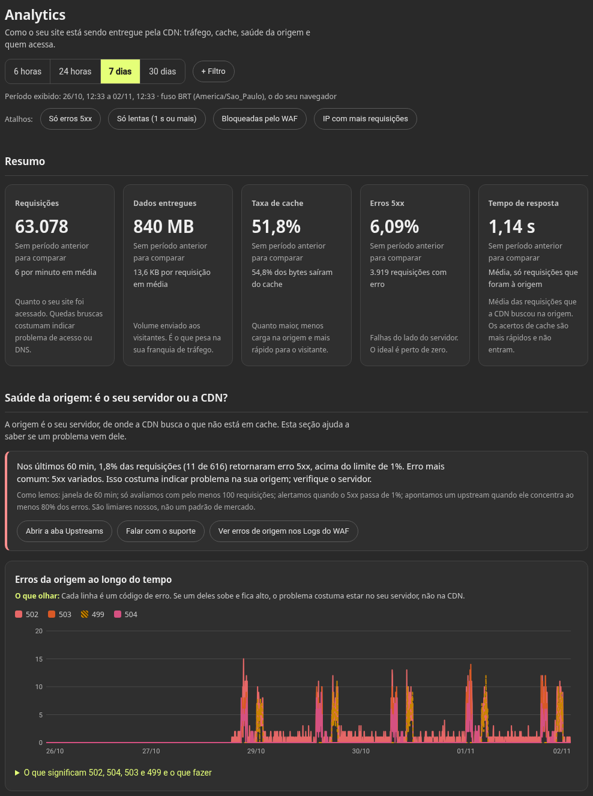

**Só lentas**: na imagem abaixo, o atalho filtra as requisições de 1 segundo ou mais. Repare que o Resumo inteiro passa a falar só dessas requisições, então "Tempo de resposta" mostra o quanto elas demoram, não a média geral.

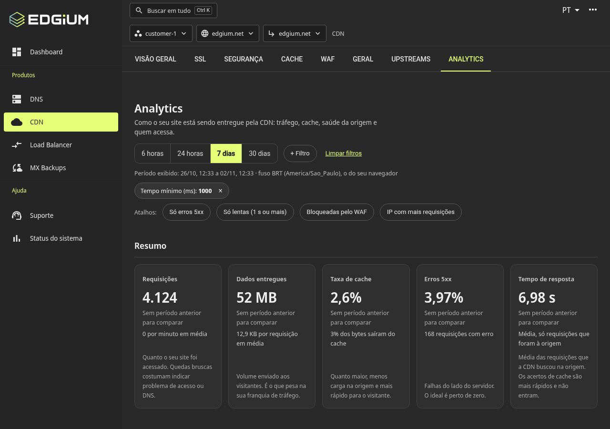

**Bloqueadas pelo WAF**: o mesmo vale aqui. Todos os números passam a descrever apenas o que foi bloqueado, o que ajuda a ver o volume e o tamanho desse tráfego.

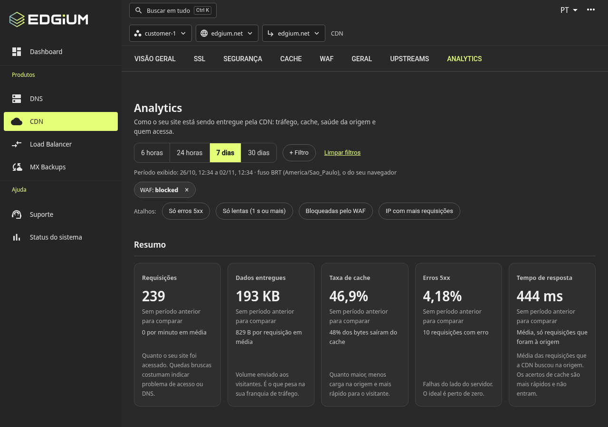

### 3.2 Resumo: os cinco números

| Cartão | O que significa | Como interpretar |
|---|---|---|
| **Requisições** | Quantas vezes o seu site foi acessado. | Queda brusca costuma indicar problema de acesso ou de DNS. Alta repentina pode ser campanha... ou robô. |
| **Dados entregues** | Volume enviado aos visitantes. | É o que pesa na sua franquia de tráfego. |
| **Taxa de cache** | Percentual dos dados que saiu do cache. | Quanto maior, menos carga no seu servidor e mais rápido para o visitante. |
| **Erros 5xx** | Percentual de requisições com falha do lado do servidor. | O ideal é perto de zero. |
| **Tempo de resposta** | Média das requisições que a CDN precisou buscar na sua origem. | Quem sai do cache é rápido e não entra nessa média. |

Cada cartão compara com o **período anterior** (quando há dados) e traz uma linha "o que olhar".

### 3.3 Saúde da origem: é o seu servidor ou a CDN?

Esta é a parte mais útil quando algo parece errado. No topo da seção há uma **frase de diagnóstico** dos últimos 60 minutos, por exemplo:

> "Nos últimos 60 min, 1,8% das requisições (11 de 616) retornaram erro 5xx, acima do limite de 1%. Isso costuma indicar problema na sua origem; verifique o servidor."

Como lemos esses números, com transparência: a janela é de 60 minutos; só avaliamos quando há **pelo menos 100 requisições** (com poucos acessos a conta enganaria); alertamos quando os erros 5xx passam de **1%**; e apontamos um servidor específico quando ele concentra **80% ou mais** dos erros. São critérios nossos, não um padrão de mercado, e aparecem na própria tela.

Abaixo da frase há botões úteis: **Abrir a aba Upstreams**, **Falar com o suporte** e **Ver erros de origem nos Logs do WAF**.

#### Erros ao longo do tempo (502, 503, 504 e 499)

O gráfico mostra uma linha por tipo de erro. **Leia assim:** se uma linha sobe e fica alta, o problema costuma estar no servidor de origem, não na CDN. Picos que se repetem no mesmo horário (como os da imagem) apontam para uma tarefa agendada, um backup ou um pico de acesso que o servidor não aguenta.

Clique em **"O que significam 502, 504, 503 e 499 e o que fazer"** para abrir a explicação dentro da própria tela:

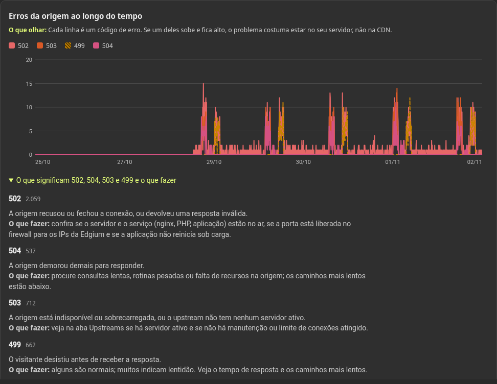

### 3.4 Guia dos erros: o que significa e o que fazer

**Erros 5xx: falha do lado do servidor.** Sempre merecem atenção.

| Código | O que aconteceu | O que fazer |
|---|---|---|
| **502** | A CDN tentou falar com o seu servidor e ele recusou, fechou a conexão ou devolveu uma resposta inválida. | Confira se o servidor e o serviço do site estão no ar, se a porta está liberada no firewall do servidor para a Edgium (a [lista de endereços da Edgium](../../ips.txt) está neste repositório) e se a aplicação não reinicia sob carga. |
| **503** | O servidor está indisponível ou sobrecarregado, ou a CDN não encontrou nenhum servidor ativo para atender. | Abra a aba **Upstreams** e veja se há servidor ativo. Verifique também se não há manutenção em andamento ou limite de conexões atingido. |
| **504** | O servidor demorou demais para responder. | Procure consultas lentas, rotinas pesadas ou falta de recursos (memória, processador). Use "Caminhos mais lentos" para achar a página culpada. |

**499: o visitante desistiu.** Não é erro do servidor nem da CDN: a pessoa fechou a página, trocou de tela ou perdeu a conexão antes de receber a resposta. Alguns são normais. **Muitos 499** indicam lentidão: o visitante cansou de esperar. Olhe o tempo de resposta e os caminhos mais lentos.

**Erros 4xx: o pedido tem algum problema.** Em geral não indicam servidor fora do ar, e sim o que foi pedido. Para investigar, use o filtro **Status** com `4xx` (ou um código específico) e veja os caminhos e a lista de requisições recentes:

| Código | Significado comum | O que fazer |
|---|---|---|
| **400** | Pedido malformado. | Se for muito frequente e vier de um único IP, pode ser robô. Se vier de visitantes, verifique formulários e integrações. |
| **401 / 403** | Acesso não autorizado ou proibido. | Confira se a página exige login e se algum bloqueio no seu site ou no WAF está barrando quem não deveria (veja os [Logs do WAF](#4-logs-do-waf)). |
| **404** | Página não encontrada. | Muitos 404 em páginas que deveriam existir: links quebrados ou mudança de endereço sem redirecionamento. Muitos 404 em caminhos estranhos: robôs procurando falhas, o que em geral é inofensivo. |
| **429** | Muitas requisições em pouco tempo. | Costuma ser limite de taxa do seu próprio site ou de uma integração que está insistindo demais. |

> **Dica:** compare 4xx e 5xx. Se os **5xx** sobem junto com a lentidão, o foco é o servidor. Se só os **4xx** sobem, o foco é o que está sendo pedido (links, robôs, integrações).

### 3.5 Velocidade da origem e onde o tempo é gasto

- **Velocidade da origem** mostra três medidas: **p50** (o tempo típico, metade das requisições é mais rápida que isso), **p95** (95% das requisições são mais rápidas que isso) e **p99** (os casos mais lentos). Se o p95 e o p99 sobem enquanto o p50 fica estável, poucos acessos estão lentos, em geral uma página ou consulta específica.
- **Onde o tempo é gasto** divide a espera em **conexão com a origem**, **processamento** e **envio da resposta**. Conexão alta aponta para rede ou servidor saturado. Processamento alto aponta para a aplicação. Envio alto aparece em respostas grandes ou banda limitada.

### 3.6 Cada servidor de origem (upstream)

A tabela compara os seus servidores de origem lado a lado: requisições, erros 5xx, 502, 503, 504, 499, **taxa de erro**, **retentativas** e tempos p50/p95/p99. **Leia assim:** um servidor com taxa de erro alta enquanto os outros estão limpos é o que precisa de atenção. **Retentativas** indicam que a CDN precisou tentar outro servidor para completar o pedido.

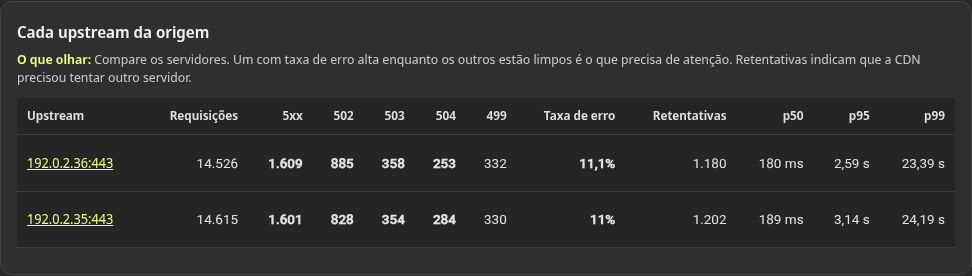

Logo abaixo, **Conexões derrubadas pela origem** resume as falhas ao conversar com o seu servidor (conexão recusada, fechada no meio, reiniciada, tempo esgotado ou nenhum servidor ativo). Costumam indicar servidor reiniciando, sem processos livres ou bloqueio de firewall.

### 3.7 Caminhos com mais erros e caminhos mais lentos

- **Caminhos com mais erros 5xx**: comece por aqui. Costuma ser uma página, uma rota de API ou uma consulta específica. Clique para filtrar.
- **Caminhos mais lentos**: ordenados pelo tempo p95 (95% das requisições são mais rápidas que isso). São bons candidatos para otimizar no servidor ou para colocar em cache.

Os caminhos são agrupados para facilitar a leitura (por exemplo, `/produtos/:n` representa todas as páginas de produto).

### 3.8 O que mais vai ao seu servidor

Esta lista mostra as páginas e arquivos que **não saíram do cache** e foram buscados no seu servidor. É uma das formas mais rápidas de ganhar desempenho: **se aparecem imagens, scripts ou páginas que poderiam ser guardados, ajuste os cabeçalhos de cache** do seu site (ou o tempo de cache na aba Cache) para que a CDN passe a guardá-los.

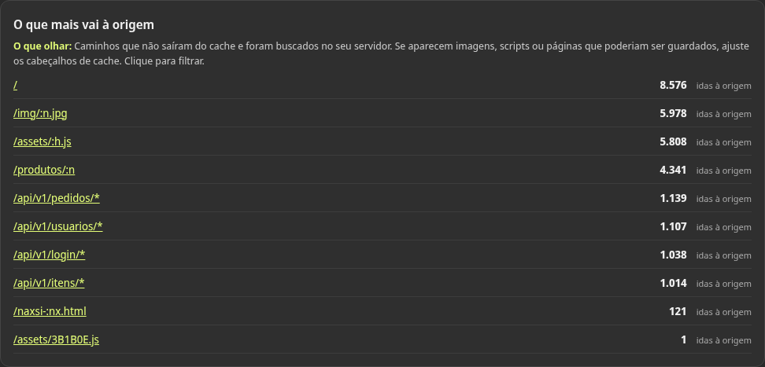

### 3.9 Quem acessa: países, endereços e HTTPS

- **De onde vêm os acessos**: países em ordem de requisições, com o mapa ao lado. Muito acesso de um país onde você não atende pode ser robô. Clique em um país para filtrar.
- **IPs que mais acessam**: um IP com volume muito acima dos demais pode ser robô, integração ou ataque. Mostra também o número aproximado de visitantes únicos.
- **HTTP e HTTPS**: o ideal é todo o acesso por HTTPS. O HTTP aparece quando o visitante digita o endereço sem `https` antes do redirecionamento.

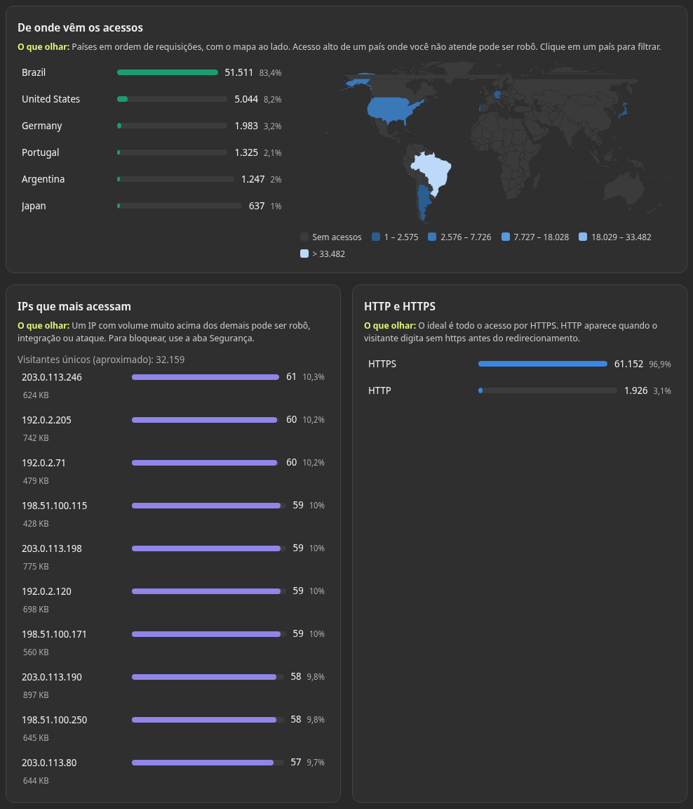

### 3.10 Segurança dentro do Analytics

O bloco **Bloqueios de segurança** conta quantos acessos o WAF barrou, quantos eventos apenas foram registrados em modo de aprendizado (e não bloqueiam) e quantas conexões foram **encerradas sem resposta (444)**. Se há um pico fora do padrão, pode ser ataque; se o WAF parece barrar uso legítimo, abra os Logs do WAF pelo botão ao lado (próxima seção).

### 3.11 Sobre o histórico dos dados

Para ser transparente: o Analytics passou a usar uma **nova coleta em 02/11/2026**. Os **dados detalhados de erros por tipo (502, 503, 504, 499 e família 4xx) existem a partir dessa data**, e os gráficos de erros **não têm série para dias anteriores**. Isso não significa que antes estava tudo bem, apenas que esse detalhe não era registrado.

Os números gerais (requisições, dados entregues, cache e países) dos dias anteriores **ainda estão sendo carregados** aos poucos e não cobrem todos os dias. Por isso, períodos longos, como 30 dias, podem mostrar menos dias ou totais parciais.

---

## 4. Logs do WAF

O **WAF** é a proteção que analisa cada pedido ao seu site e barra o que parece ataque (por exemplo, tentativas de injetar comandos em formulários). Os **Logs do WAF** mostram o que foi barrado e por quê.

**Como chegar:** na tela inicial da CDN, pelo botão de logs do WAF; ou, dentro do Analytics, pelo botão **Abrir Logs do WAF**.

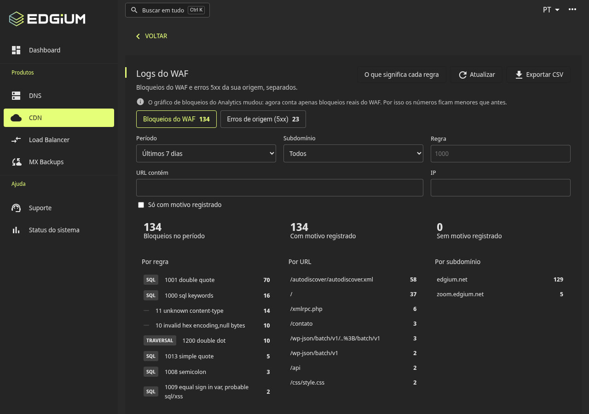

### 4.1 Como achar um bloqueio

Há duas abas: **Bloqueios do WAF** (o que a proteção barrou) e **Erros de origem (5xx)** (falhas do seu servidor, mantidas separadas para não se misturarem aos bloqueios).

Use os filtros para chegar ao que importa:

- **Período**: de algumas horas a alguns dias.
- **Subdomínio**: um específico ou todos.
- **Regra**: o número da regra (veja abaixo).
- **URL contém** e **IP**: para quando você já sabe qual página ou qual visitante procura.
- **Só com motivo registrado**: esconde registros sem detalhe.

No alto há um resumo: **bloqueios no período**, quantos **com motivo registrado** e quantos **sem**. Em seguida, os rankings **Por regra**, **Por URL** e **Por subdomínio**. Se uma regra ou página domina o ranking, é por ela que se começa. Dá para exportar a lista em **CSV**.

> O gráfico de bloqueios do Analytics passou a contar apenas bloqueios reais do WAF. Por isso os números podem ficar menores que antes. Não é perda de proteção: é uma contagem mais correta.

### 4.2 Como ler o motivo e a regra

Cada linha traz hora, subdomínio, endereço pedido, **motivo** (a categoria, como SQL, XSS, TRAVERSAL ou WAF) e o IP completo do visitante. Clique em uma linha para ver o **detalhe**:

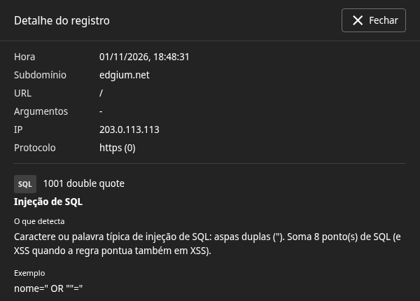

- **Número e nome da regra** (por exemplo, "1001 double quote"): identifica o que foi detectado.
- **O que detecta**: explicação em português do padrão que disparou a regra.
- **Exemplo**: um trecho típico do que a regra procura.
- Mais abaixo, o painel orienta o que verificar no seu site.

O botão **O que significa cada regra** abre o catálogo completo, em português, de todas as regras.

Categorias mais comuns:

| Categoria | O que a regra procura |
|---|---|
| **SQL** | Trechos típicos de tentativa de mexer no banco de dados do seu site por formulários e endereços. |
| **XSS** | Tentativas de injetar scripts nas suas páginas. |
| **TRAVERSAL** | Tentativas de sair da pasta do site para ler outros arquivos (por exemplo, sequências `../`). |
| **WAF** (geral) | Pedidos malformados ou fora do padrão (formato de dados desconhecido, caracteres inválidos). |

### 4.3 Como decidir: ataque ou uso legítimo?

Faça três perguntas diante de um bloqueio:

1. **A URL é do meu site?** Caminhos que você não reconhece (como `/xmlrpc.php` em um site que não usa essa tecnologia, ou `/.git/config`) são varreduras de robôs. O bloqueio está correto e **não há nada a fazer**.
2. **O pedido vem de uma funcionalidade real do meu site?** Se o endereço é seu e o bloqueio atinge um formulário, um editor de texto ou uma integração legítima, anote a **URL**, a **regra** e o **IP** e fale com a gente para ajustar com segurança. A aba **WAF** do subdomínio permite liberar um endereço específico, mas isso reduz a proteção naquele endereço: use sempre o caminho mais específico possível.
3. **Quantos IPs e com que frequência?** Muitas tentativas de um mesmo IP em sequência são varredura. Um único bloqueio isolado em um endereço seu, de um visitante real, merece análise.

**Modo aprendizado:** na aba **WAF** do subdomínio, o modo aprendizado registra o que *seria* bloqueado sem bloquear nada. É uma forma segura de testar antes de proteger. Os eventos nesse modo aparecem no Analytics separados dos bloqueios.

---

## 5. DNS

Na aba **Zona DNS** você administra os registros do seu domínio (quando o DNS da Edgium está ligado). A tela foi reconstruída para trazer segurança ao mexer em algo tão sensível.

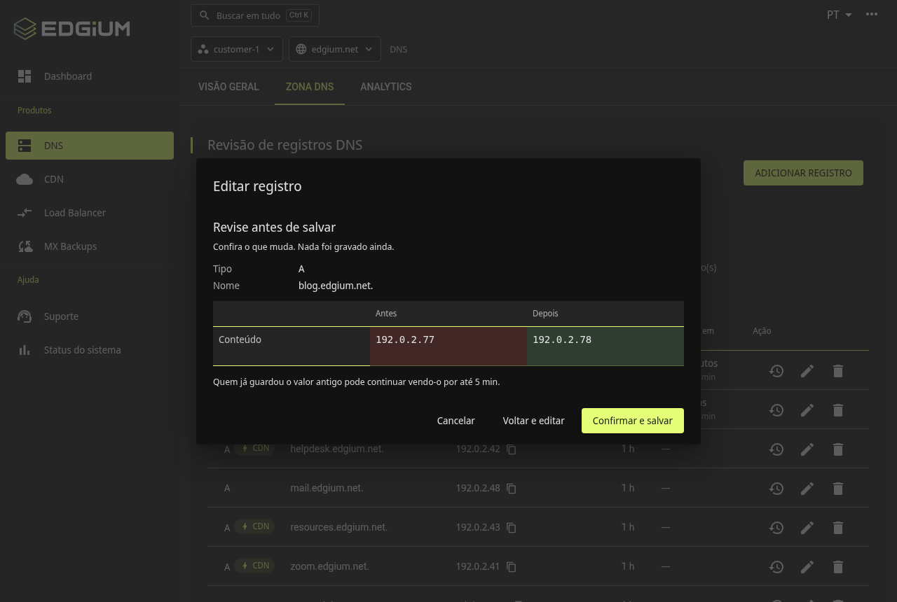

### 5.1 Revisão antes de salvar

Ao **editar** um registro, o painel mostra uma tela de revisão com o valor **antes** e **depois**, lado a lado, e avisa por quanto tempo quem já guardou o valor antigo pode continuar vendo-o (isso depende do TTL do registro). Nada é gravado até você clicar em **Confirmar e salvar**; **Voltar e editar** retorna ao formulário.

Alterações que podem afetar e-mail (como registros MX) ganham destaque e avisos adicionais na revisão.

### 5.2 Desfazer

Depois de criar, editar ou apagar um registro, a tela exibe um aviso com o botão **Desfazer**. Um clique devolve o registro aos valores anteriores.

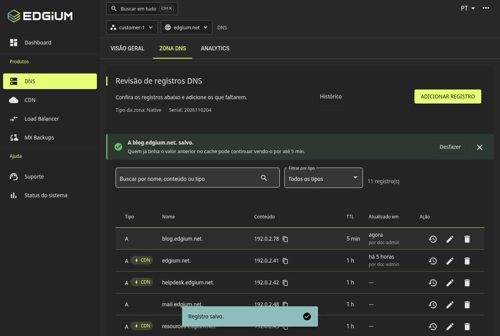

### 5.3 Histórico de alterações

O ícone de relógio em cada linha abre o histórico **daquele registro**; o botão **Histórico** da zona abre o histórico de **toda a zona**, com filtro por nome e por tipo. Cada item mostra se foi **criado**, **editado** ou **apagado**, o valor antes e depois, quem fez e quando. A coluna **Atualizado em** da tabela também mostra o último autor.

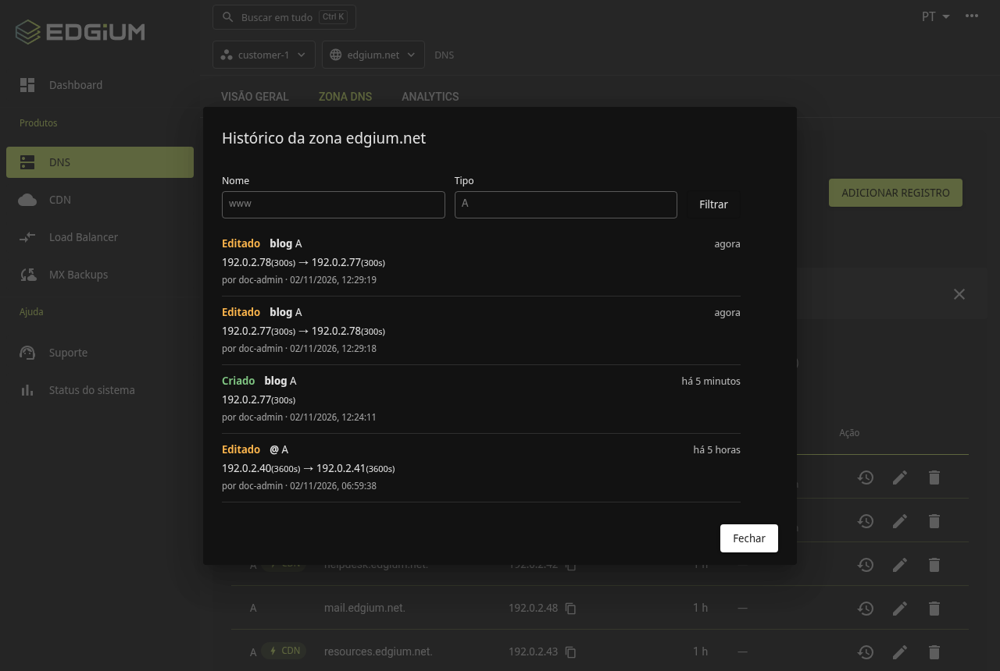

> O histórico começa a ser registrado a partir de 02/11/2026. Alterações feitas antes dessa data não aparecem nele.

### 5.4 Erros explicados

Quando algo não pode ser salvo, a mensagem aparece **no campo que precisa ser corrigido** e diz o que aconteceu, em qual registro e o que fazer. Exemplos: "Este registro já existe", ou, como na imagem, que já existe um registro A com aquele nome e por isso um CNAME não pode ser criado junto.

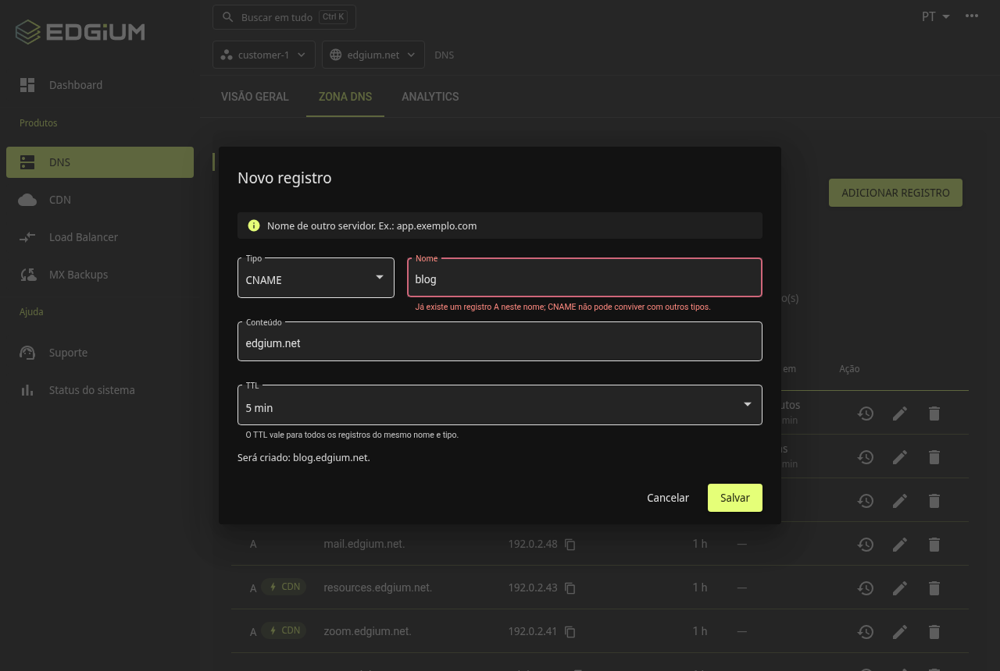

Outras melhorias: cada gravação altera **apenas o registro que você mexeu** (nada de reenviar a zona inteira), o formulário mostra o endereço completo que será criado, e registros de nameserver (NS) e SOA do domínio principal ficam **protegidos**, com um aviso discreto na tela.

---

## 6. Outras melhorias de interface

### Perfil e troca de senha

No menu do canto superior direito (os três pontinhos) está o **Perfil**. Ele mostra nome e e-mail (para alterá-los, fale com o suporte) e permite **trocar a senha**. A nova senha precisa ter pelo menos **12 caracteres**, com maiúscula, minúscula, número e símbolo, e ser diferente da atual. A tela marca cada requisito conforme você digita, e as outras sessões abertas são encerradas após a troca.

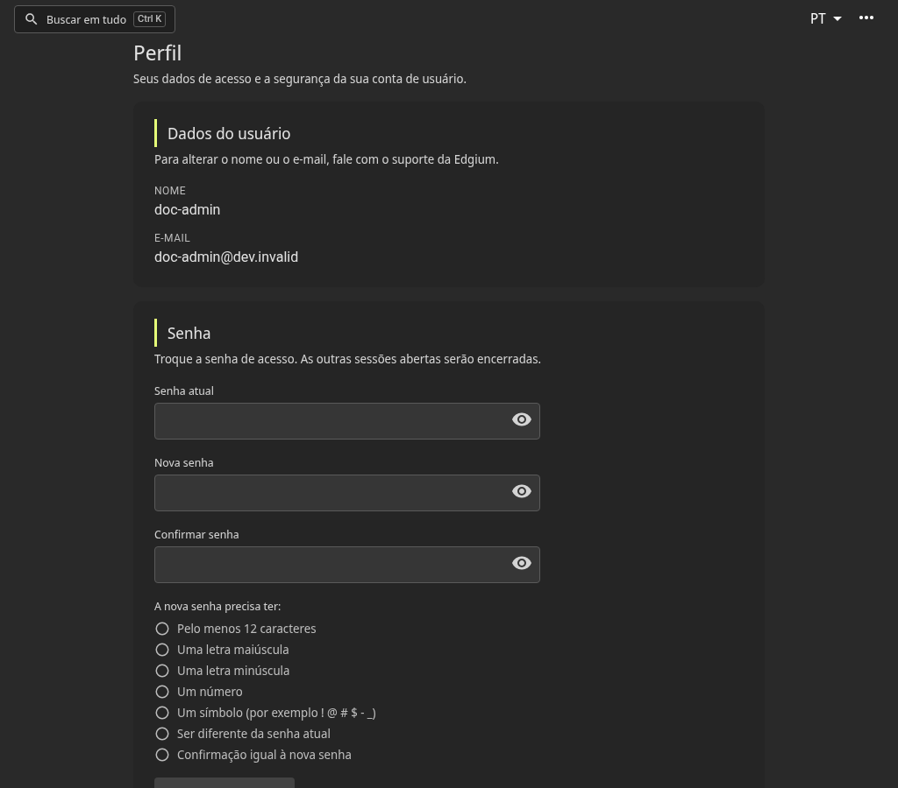

### Confirmar digitando o nome antes de apagar

Para evitar apagar o domínio ou o subdomínio errado, o painel pede que você **digite o nome** para confirmar. O botão **Apagar** só é liberado quando o texto confere (colar está desativado de propósito). A mensagem deixa claro o que será removido (SSL, servidores de origem, regras do WAF e cache) e que a **retirada final do site dos servidores da CDN é feita pela equipe da Edgium**.

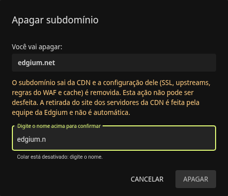

### Troca de domínio

O seletor de domínio no alto da tela tem **busca** e mostra a situação de cada um (por exemplo, **Ativo**, **DNS externo** ou **Em verificação**). Ao trocar, todas as abas passam a mostrar o novo domínio.

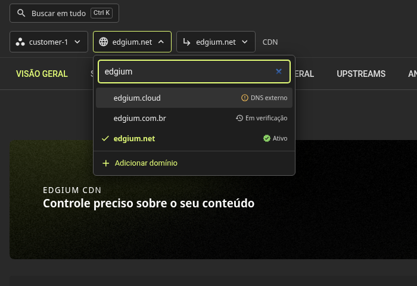

### HTTP/2 e HTTP/3

Na aba **Segurança**, o painel mostra o estado de cada protocolo:

- **HTTP/2** fica **sempre ligado nas conexões HTTPS**.
- **HTTP/3** aparece como **"Ainda não está disponível"**, só para informar. Não há nada a ligar por enquanto.

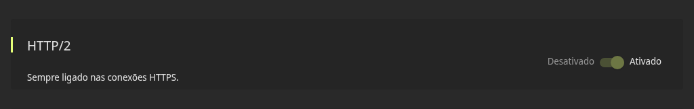

### Cache TTL

Na aba **Cache**, duas opções parecidas têm funções diferentes:

- **Tempo de expiração**: por quanto tempo o **navegador do visitante** guarda os arquivos.
- **Cache TTL**: por quanto tempo a **CDN** guarda no cache as respostas bem-sucedidas (200 e 206) antes de buscar de novo no seu servidor.

Se uma opção salva antes estiver fora da lista, a tela agora mostra o valor salvo, em vez de deixar o campo em branco.

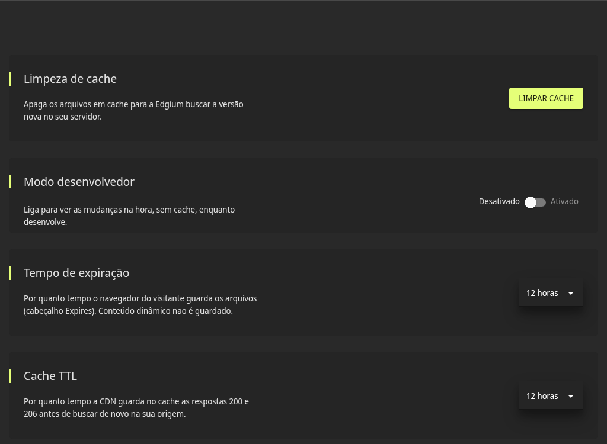

---

## 7. Novo subdomínio: o assistente passo a passo

Para colocar um site na CDN, clique em **Adicionar subdomínio** na tela inicial da CDN. O assistente tem **3 etapas**.

### Etapa 1: subdomínio

Preencha só a parte **antes do ponto** (por exemplo, `www` ou `loja`); o domínio já aparece ao lado. Para usar o próprio domínio, sem prefixo, marque **Domínio raiz**.

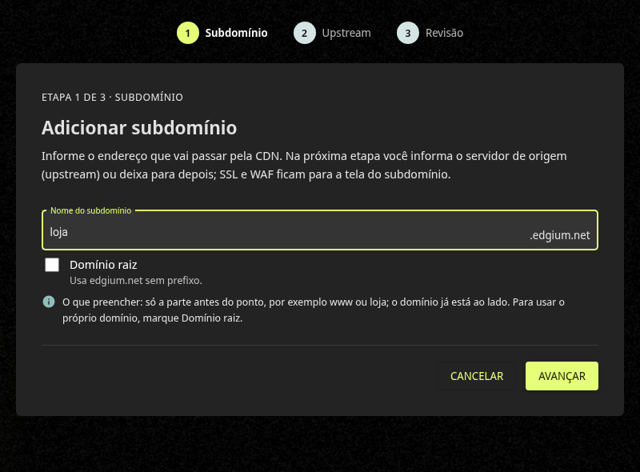

### Etapa 2: origem (upstream)

Informe agora o servidor para onde a CDN vai enviar o tráfego, ou escolha **Configurar depois**:

- **Nome**: um nome seu, como "servidor-principal".
- **IP do servidor**: precisa ser um endereço **público** (endereços de rede interna são recusados).
- **Porta** e **Prioridade** (a mais alta é a padrão).
- **Usar upstreams como HTTPS**: se a CDN deve falar com o seu servidor por HTTPS.
- **Ativar ao criar**: marcado por padrão. Se você desmarcar, a origem nasce desligada e **não recebe tráfego** até você ativá-la.

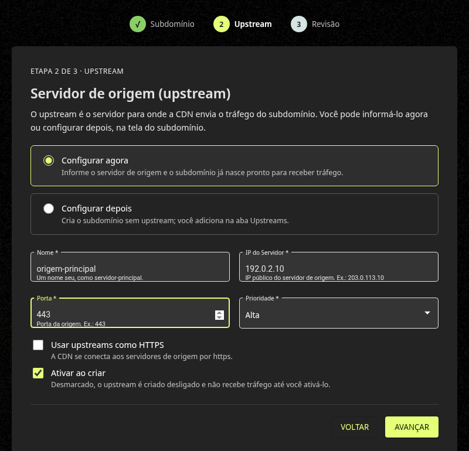

### Etapa 3: revisão

A tela resume o subdomínio e a origem antes de criar. Se você escolheu configurar depois, o painel avisa que, sem uma origem ativa, **o subdomínio não tem para onde enviar o tráfego**; adicione e ative um na aba **Upstreams**.

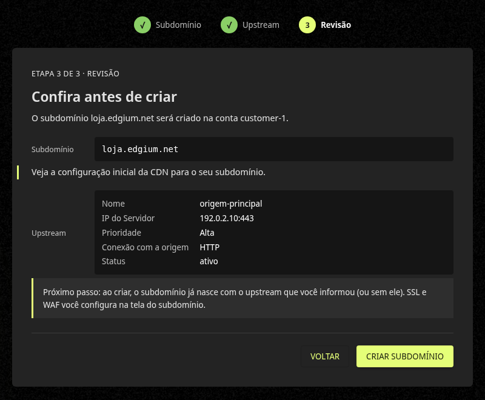

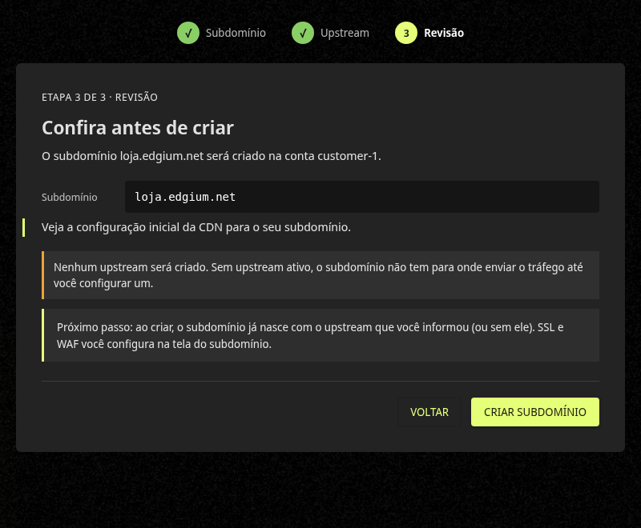

### Padrões já ligados

Todo subdomínio novo nasce com o **IP real do visitante** e a **geolocalização** ligados, para que o seu servidor saiba de quem é cada acesso e de onde ele vem (a aba **Geral** mostra e permite alterar). Ao ligar o HTTPS, o redirecionamento de HTTP para HTTPS e o HTTP/2 também já vêm ligados.

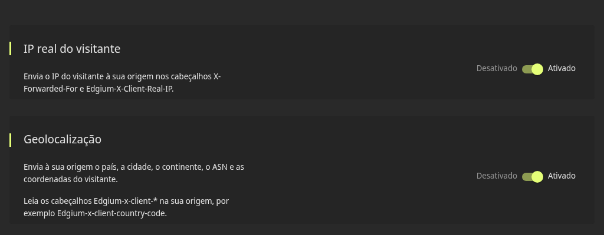

### O que conferir antes de apontar o DNS

Antes de mudar o DNS do seu site para a CDN, confira:

1. **A origem responde.** O servidor que você informou está no ar, na porta escolhida, e aceita conexões vindas da Edgium (a [lista de endereços da Edgium](../../ips.txt) está neste repositório). Se há firewall no servidor, libere esses endereços.
2. **A origem está ativa** na aba **Upstreams** (uma origem desligada não recebe tráfego).
3. **O modo da conexão está correto**: se o seu servidor só atende HTTPS, marque "Usar upstreams como HTTPS".
4. **Os endereços da CDN** estão à mão: a aba **Visão geral** lista os endereços que o DNS do seu site deve apontar. Se você usa o DNS da Edgium, os registros `www` já são criados para você.
5. **O certificado**: o certificado gratuito (Let's Encrypt) só pode ser emitido **depois** que o DNS aponta para a CDN. Aponte o DNS, aguarde a propagação e então emita pela aba **SSL**.
6. **Reduza o TTL com antecedência.** Se puder, diminua o TTL do registro atual algumas horas antes da troca, para que um eventual retorno seja rápido.
7. **Teste e acompanhe**: depois de apontar, abra o **Analytics** e confira requisições, erros 5xx e a saúde da origem.

---

## 8. Precisa de ajuda?

- **Ainda não tem conta?** Fale com a gente pelo link da tela de entrada.
- **Dúvida ou problema?** Abra um chamado em **Suporte**, dentro do painel, ou acompanhe o **Status do sistema**.
- Quando pedir ajuda sobre um erro, informe o **subdomínio**, o **período** e, se possível, um **print** da tela. Isso acelera muito o atendimento.
